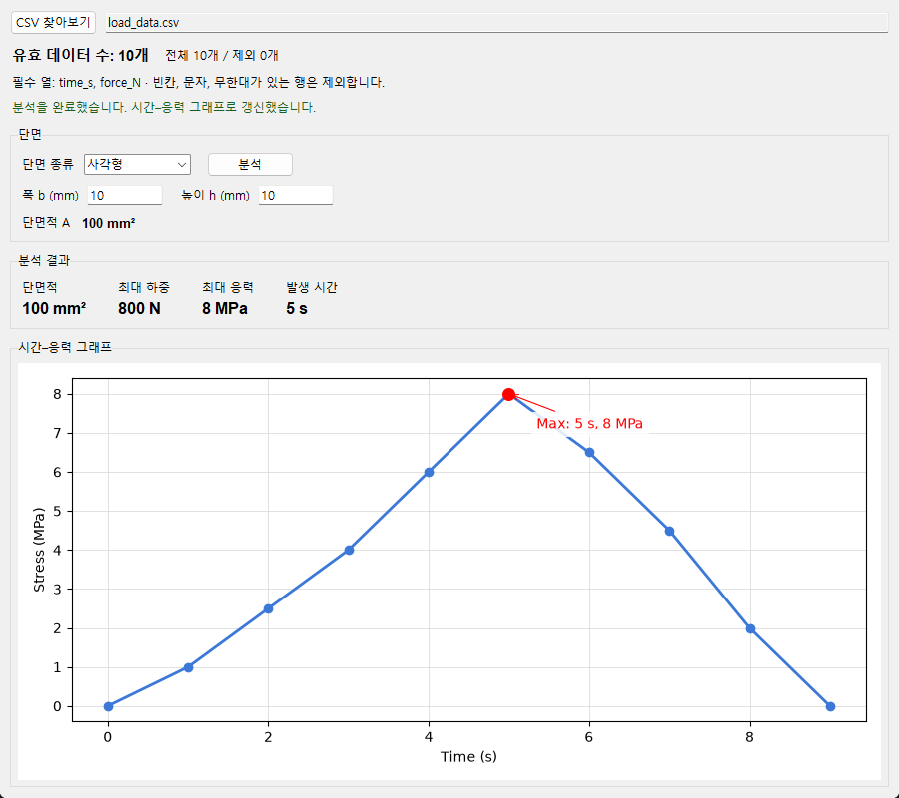
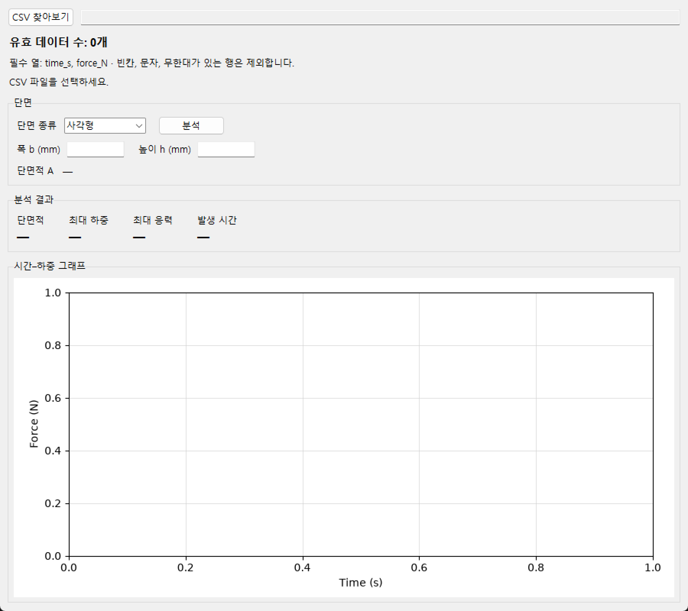
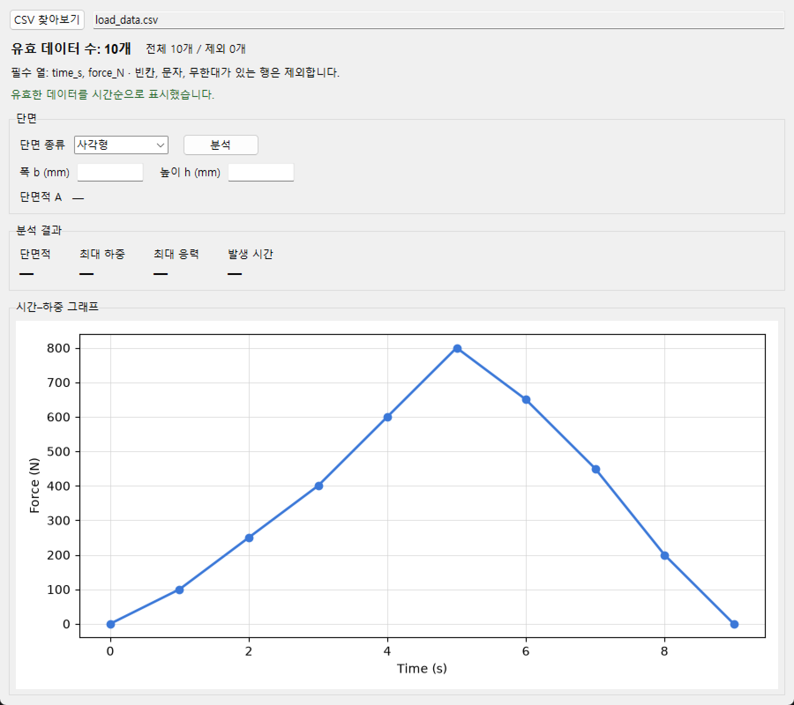
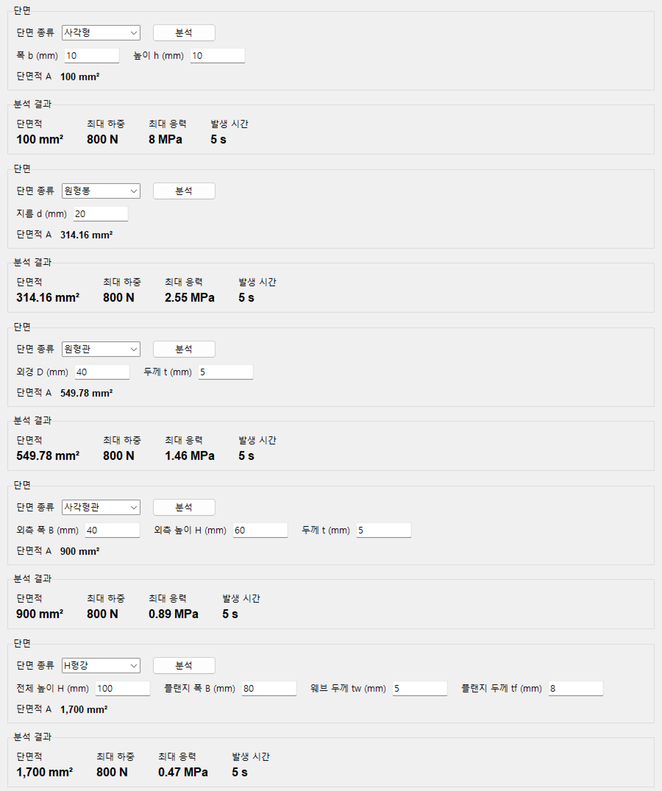
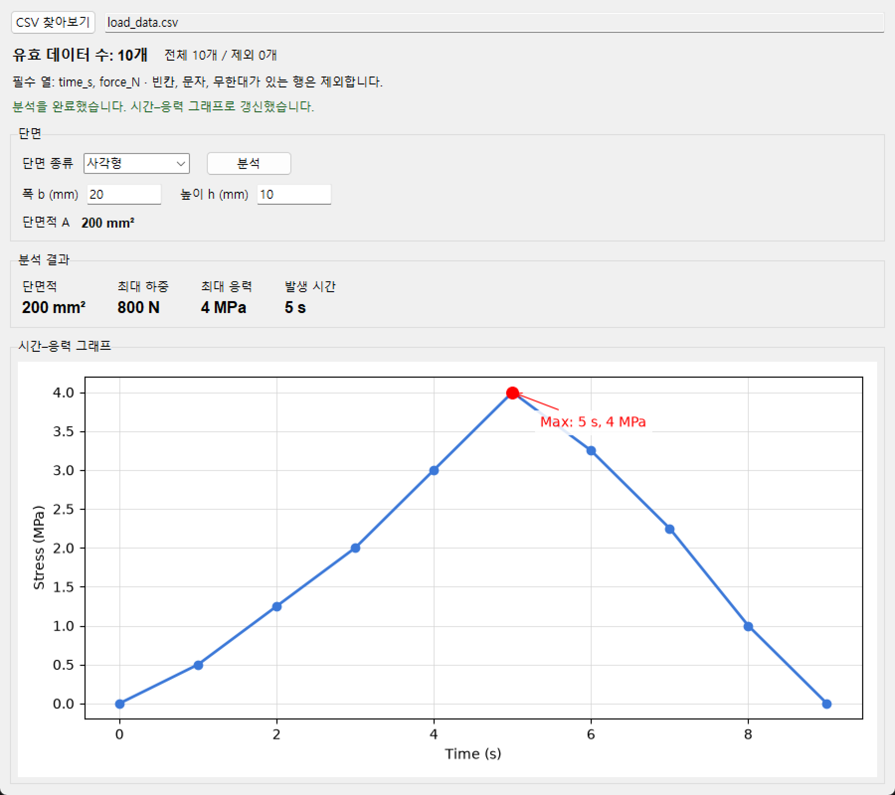
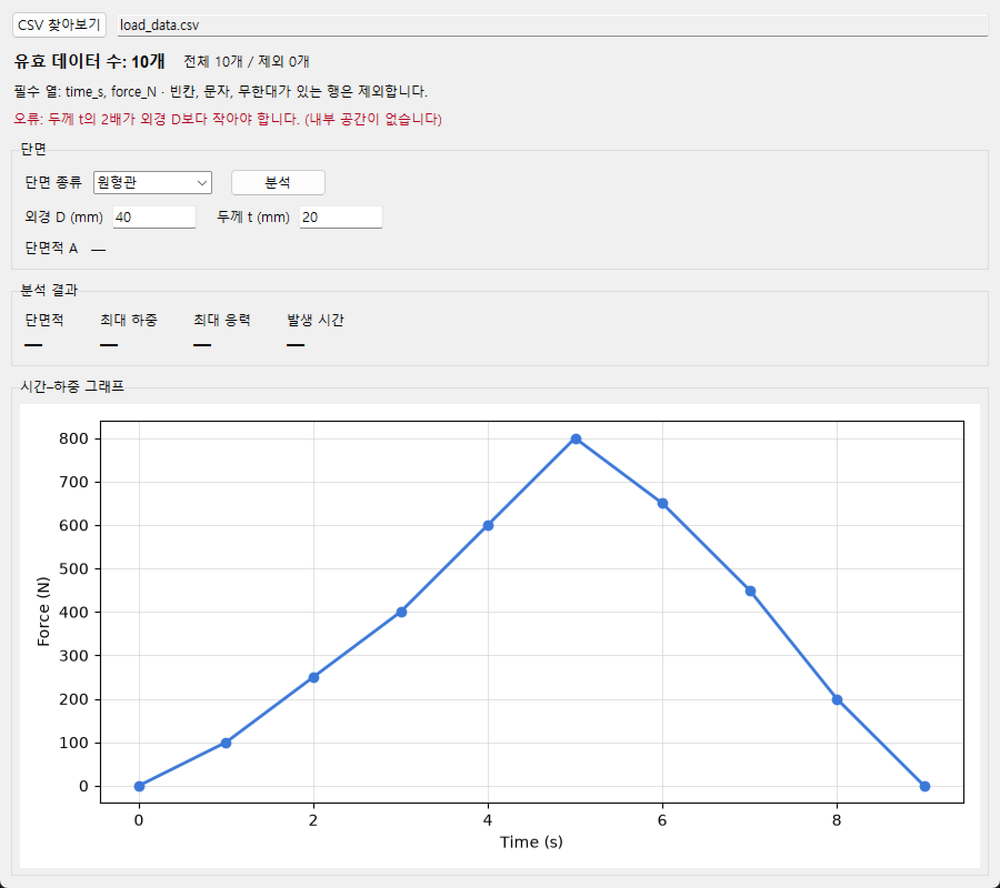
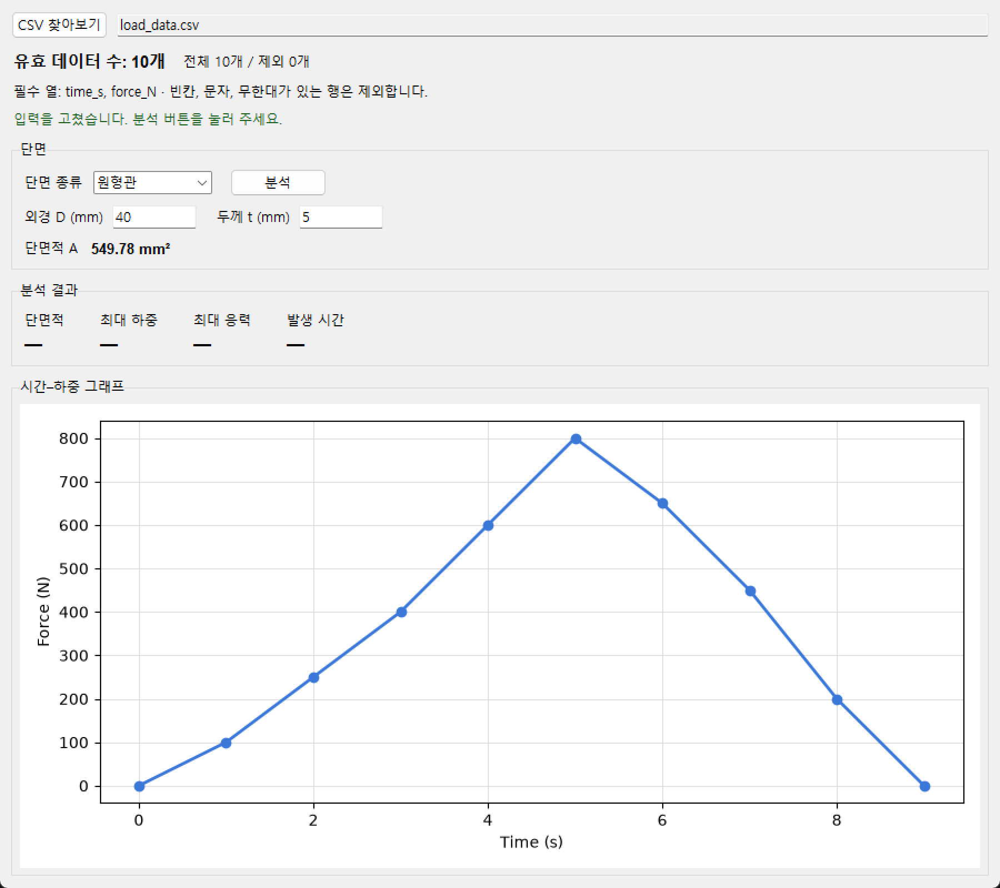
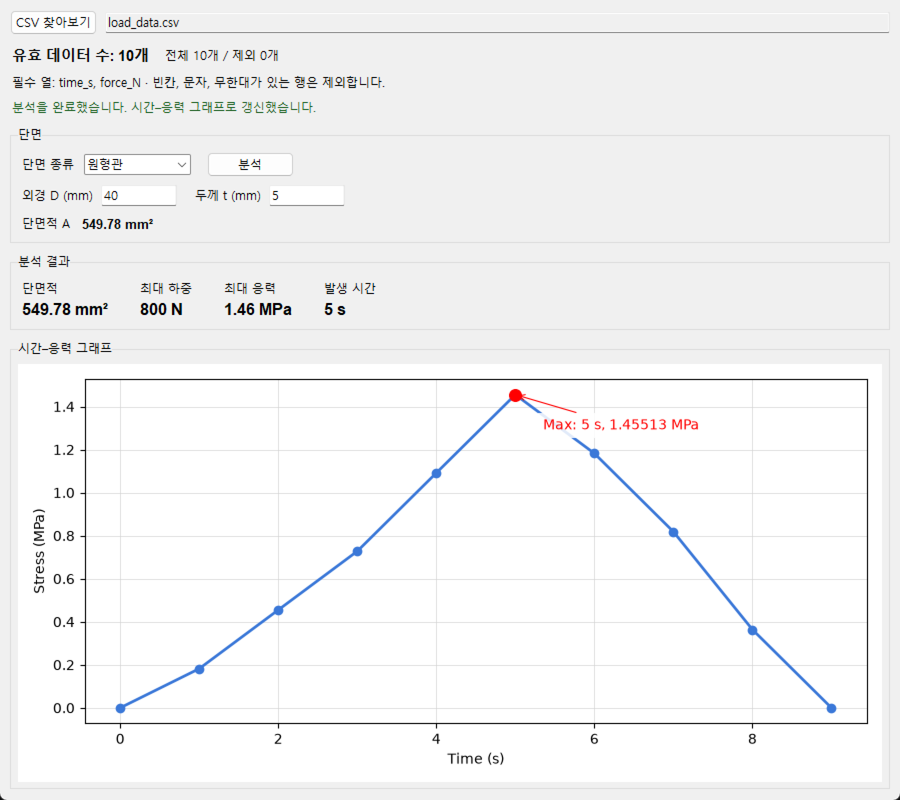
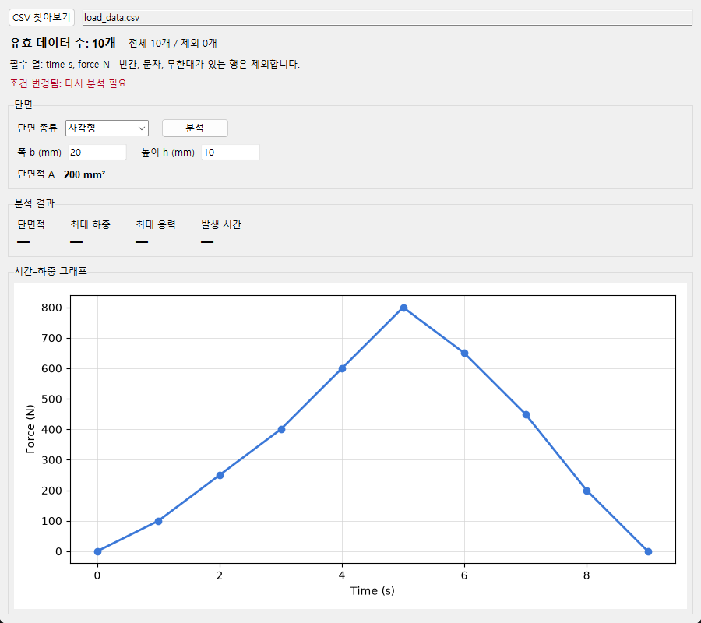

# Week 6 제출: 단면 선택과 CSV 분석 GUI

코딩과 응용(2008424) · 2026년 2학기

- 실행 코드: [load_analyzer_gui.py](../load_analyzer_gui.py)
- 예시 데이터: [load_data.csv](../load_data.csv), [load_test.csv](../load_test.csv), [load_bad.csv](../load_bad.csv)
- 프로그램 설명(실행 방법, 단면별 계산식, 오류 처리 규칙): [week6_section_gui/README.md](../README.md)
- 실행: `week6_section_gui` 폴더에서 `python load_analyzer_gui.py` (Python 3, Tkinter, matplotlib 필요)

## 1. 실행 화면

`load_data.csv`를 선택하고 사각형 10 × 10 mm로 분석한 화면입니다. 유효 데이터 10개, 단면적 100 mm², 최대 하중 800 N, 최대 응력 8 MPa, 발생 시간 5 s이고, 하단에 시간–응력 그래프가 표시됩니다.

처음 화면과 CSV 선택 직후 화면입니다. CSV를 선택하면 유효 데이터 수가 표시되고 시간–하중 그래프가 나타납니다. 분석을 누르면 시간–응력 그래프로 바뀝니다.

| 처음 화면 | CSV 선택 직후 (시간–하중 그래프) |
|---|---|
|  |  |

## 2. 다섯 단면의 단면적 검증 결과

`load_data.csv`(최대 하중 800 N, 5 s)로 분석했습니다. 계산은 반올림 전 값으로 하고 표시만 반올림했습니다.

| 단면 | 치수 (mm) | 계산 단면적 (mm²) | 확인표 값 (mm²) | 일치 | 최대 응력 (MPa) |
|---|---|---|---|---|---|
| 사각형 | b=10, h=10 | 100 | 100 | O | 8 |
| 원형봉 | d=20 | 314.16 | 약 314.16 | O | 2.55 |
| 원형관 | D=40, t=5 | 549.78 | 약 549.78 | O | 1.46 |
| 사각형관 | B=40, H=60, t=5 | 900 | 900 | O | 0.89 |
| H형강 | H=100, B=80, tw=5, tf=8 | 1,700 | 1,700 | O | 0.47 |

## 3. 사각형 100 mm²와 200 mm²의 응력 비교

최대 하중은 두 경우 모두 800 N이고, 발생 시간도 5 s로 같습니다. 단면적이 2배가 되면 최대 응력은 절반이 됩니다.

| 폭 b | 높이 h | 단면적 | 최대 하중 | 최대 응력 | 발생 시간 |
|---|---|---|---|---|---|
| 10 mm | 10 mm | 100 mm² | 800 N | 8 MPa | 5 s |
| 20 mm | 10 mm | 200 mm² | 800 N | 4 MPa | 5 s |

그래프의 최대점도 표시된 최대 응력과 같았습니다(8 MPa, 4 MPa).

| 10 × 10 mm (100 mm²) | 20 × 10 mm (200 mm²) |
|---|---|
|  |  |

## 4. 오류 입력과 조건 변경 후 재분석

### 오류 입력 1개: 원형관 외경 D=40, 두께 t=20

두께의 2배(40)가 외경(40)과 같아 내부 공간이 없으므로, 계산을 중단하고 "오류: 두께 t의 2배가 외경 D보다 작아야 합니다. (내부 공간이 없습니다)"를 안내했습니다. 단면적과 응력 결과는 "—"로 비우고, 이전 결과를 남기지 않았습니다.

t를 5로 고치면 "입력을 고쳤습니다. 분석 버튼을 눌러 주세요."가 표시되고, 다시 분석하면 단면적 549.78 mm², 최대 응력 1.46 MPa가 나왔습니다.

| 오류 안내 (t=20) | 입력을 고친 직후 (t=5) | 재분석 결과 |
|---|---|---|
|  |  |  |

### 조건 변경 후 재분석: 사각형 폭 10 mm → 20 mm

분석 후 폭을 20 mm로 바꾸면 이전 단면적과 응력 결과를 지우고 "조건 변경됨: 다시 분석 필요"를 표시했습니다. 분석을 다시 실행하면 숫자와 그래프가 갱신되어 단면적 200 mm², 최대 응력 4 MPa가 되었습니다(위 3번의 오른쪽 화면).

### 그 밖에 확인한 것

- 분석 버튼을 5번 눌러도 그래프는 하나였습니다.
- `load_bad.csv`(2초 하중 빈칸, 3초 `abc`)는 유효 데이터 8개, 제외 2개로 처리하고 최대 응력 8 MPa를 얻었습니다.
- `load_test.csv`(7초 하중 900 N)는 사각형 10 × 10 mm에서 최대 응력 9 MPa, 발생 시간 7 s였습니다.

## 5. 분석 버튼이 실행하는 함수와 그 역할 (한 문장)

분석 버튼은 `run_analysis()` 함수를 실행하며, 이 함수는 입력한 단면 치수로 단면적과 응력을 계산해 최대 응력, 발생 시간, 시간–응력 그래프를 갱신한다.
